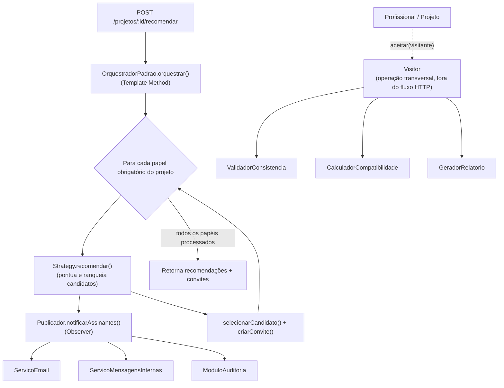

# 📚 DSM – Desenvolvimento de Software Multiplataforma – FATEC/SJC

Atividade prática **ATV1** – TP.II - Técnicas de Programação II · Prof. Dr. Eng. Gerson Penha.

# 🎬 CineBridge – Recomendação e Orquestração de Equipes

Microsserviço REST que recebe as especificações técnicas de um projeto audiovisual, analisa o perfil dos profissionais cadastrados e compõe automaticamente uma equipe equilibrada — notificando os envolvidos e permitindo ajustes dinâmicos ao longo do processo.

> Primeiro de uma série de exercícios que vão incrementar este mesmo projeto ao longo do semestre — a estrutura aqui documentada é a base sobre a qual as próximas entregas serão construídas.

## 📑 Sumário

- [📋 Requisitos](#-requisitos)
- [🛠 Tecnologias](#-tecnologias)
- [🚀 Como executar](#-como-executar)
- [🗂 Estrutura do projeto](#-estrutura-do-projeto)
- [🏗 Decisão de arquitetura — padrões de projeto aplicados](#-decisão-de-arquitetura--padrões-de-projeto-aplicados)
- [🖥 Endpoints](#-endpoints)
- [🔧 Variáveis de ambiente](#-variáveis-de-ambiente)
- [🧪 Testes](#-testes)
- [🔩 Scripts de demonstração manual](#-scripts-de-demonstração-manual)
- [🖥 Compatibilidade](#-compatibilidade)
- [💾 Persistência de dados](#-persistência-de-dados)
- [🎯 Conceitos aplicados](#-conceitos-aplicados)

## 📋 Requisitos

- Node.js (versão LTS)
- Docker Desktop (o Postgres roda em container)

## 🛠 Tecnologias

### ⚙️ Back-end (Linguagem e Frameworks)

<p align="left">
<a href="https://nodejs.org" target="_blank" rel="noopener noreferrer">

</a>
<a href="https://www.typescriptlang.org" target="_blank" rel="noopener noreferrer">

</a>
<a href="https://fastify.dev" target="_blank" rel="noopener noreferrer">

</a>
<a href="https://typeorm.io" target="_blank" rel="noopener noreferrer">

</a>
</p>

### 🗄 Banco de dados

<p align="left">
<a href="https://www.postgresql.org" target="_blank" rel="noopener noreferrer">

</a>
</p>

### 🧪 Testes

<p align="left">
<a href="https://jestjs.io" target="_blank" rel="noopener noreferrer">

</a>
</p>

### 🐳 Infraestrutura

<p align="left">
<a href="https://www.docker.com" target="_blank" rel="noopener noreferrer">

</a>
</p>

Versões: Node.js LTS · TypeScript 5.5 (modo `strict`) · Fastify 4 · TypeORM 0.3 · Postgres 16 · Jest 30 + ts-jest.

## 🚀 Como executar

Resumo rápido (pressupõe Node.js LTS e Docker Desktop já instalados e rodando):

```bash
git clone https://github.com/SEU_USUARIO/cinebridge-atv1.git
cd cinebridge-atv1
npm install
cp .env.example .env
docker compose up -d
npm run seed
npm run dev
```

**Guia completo, passo a passo — com instalação de pré-requisitos, instruções específicas para Ubuntu/WSL2 e solução de problemas comuns**: [docs/execucao.md](docs/execucao.md).

## 🗂 Estrutura do projeto

```
src/
├── aplicacao/              # ServicoProjetos + CatalogoProfissionais (carga O(n) + cache)
├── config/                # DataSource do TypeORM, perfil ideal de competências por papel
├── domain/
│   ├── entities/            # Projeto, Profissional, Competencia, Avaliacao, Recomendacao, Convite...
│   └── enums/                # Papel, StatusConvite, TipoCaptacao
├── strategies/             # Strategy: algoritmos de recomendação + testes
├── orquestrador/           # Template Method: OrquestradorEquipe / OrquestradorPadrao + testes
├── observers/              # Observer: Publicador, Assinante e implementações + testes
├── visitors/               # Visitor: IVisitanteProjeto e implementações + testes
├── seed.ts                 # Popula o banco com dados de exemplo
├── testar-orquestrador.ts  # Script de demonstração manual (Strategy + Template Method + Observer)
├── testar-visitors.ts      # Script de demonstração manual (Visitor)
└── server.ts               # Entrypoint: Fastify + rota HTTP
```

Os arquivos de teste automatizado (`*.test.ts`) ficam ao lado do arquivo que testam (ex: `SimilaridadeCosseno.ts` + `SimilaridadeCosseno.test.ts`).

## 🏗 Decisão de arquitetura — padrões de projeto aplicados



**Strategy** — `IRecomendacaoStrategy`, três implementações intercambiáveis (0–10 pontos):

| Estratégia | Arquivo | Critério |
|---|---|---|
| `SIMILARIDADE_COSSENO` | `strategies/SimilaridadeCosseno.ts` | Similaridade de cosseno entre competências do profissional e o perfil ideal do papel |
| `FILTRAGEM_COLABORATIVA` | `strategies/FiltragemColaborativa.ts` | Média histórica de avaliações + bônus de afinidade por gênero de projeto |
| `REGRAS_ORCAMENTO` | `strategies/RegrasOrcamento.ts` | Viabilidade financeira e disponibilidade na janela de entrega |

**Template Method** — `OrquestradorEquipe` (abstrata) fixa o algoritmo em `orquestrar()`; `OrquestradorPadrao` (concreta) só implementa os dois pontos variáveis: qual strategy usar e o critério de corte (`pontuacaoMinima`).

**Observer** — `Publicador`/`Assinante`. A cada recomendação gerada, `SistemaRecomendacao` notifica `ServicoEmail`, `ServicoMensagensInternas` e `ModuloAuditoria`, sem conhecer os detalhes de cada um.

**Visitor** — `IVisitanteProjeto`, implementada por `Projeto`/`Profissional` via `ElementoVisitavel.aceitar()`. `ValidadorConsistencia`, `CalculadorCompatibilidade` e `GeradorRelatorio` adicionam operações novas sem alterar as entidades. Roda hoje de forma independente do fluxo HTTP (script de demonstração), não integrado na rota `/recomendar`.

## 🖥 Endpoints

| Método | Rota | Descrição | Respostas |
|---|---|---|---|
| GET | `/health` | Verificação de que o servidor está no ar | 200 |
| POST | `/projetos/:id/recomendar` | Aplica a estratégia configurada e retorna a equipe recomendada | 200, 404 |

```bash
curl -X POST http://localhost:3000/projetos/<uuid-do-projeto>/recomendar
```

Resposta: JSON com `recomendacoes` (ranking completo por papel) e `convites` (candidato escolhido por papel, status `PENDENTE`).

> Recomenda-se Thunder Client ou Insomnia para visualizar a resposta formatada. Requisições sem corpo devem usar `No Body` (ou `{}`, se a opção não existir) — `Content-Type: application/json` com corpo vazio causa erro `415`.

## 🔧 Variáveis de ambiente

| Variável | Descrição | Padrão (`.env.example`) |
|---|---|---|
| `DB_HOST` | Host do Postgres | `localhost` |
| `DB_PORT` | Porta do Postgres | `5432` |
| `DB_USER` | Usuário do Postgres | `postgres` |
| `DB_PASSWORD` | Senha do Postgres | `postgres` |
| `DB_NAME` | Nome do banco | `cinebridge` |
| `PORT` | Porta do servidor Fastify | `3000` |

O `docker-compose.yml` lê essas variáveis do `.env` automaticamente.

## 🧪 Testes

```bash
npm test              # roda toda a suíte
npm run test:coverage # roda com relatório de cobertura
```

| Padrão | Suítes cobertas |
|---|---|
| Strategy | `SimilaridadeCosseno`, `FiltragemColaborativa`, `RegrasOrcamento` |
| Template Method | `OrquestradorPadrao` |
| Observer | `SistemaRecomendacao`, `ServicoEmail`, `ServicoMensagensInternas`, `ModuloAuditoria` |
| Visitor | `ValidadorConsistencia`, `CalculadorCompatibilidade`, `GeradorRelatorio` |

Estado atual: **197 testes, 24 suítes, ~89% stmts/lines, ~84% branches, ~96% funcs**
(threshold mínimo: 80%). A carga de profissionais usa `CatalogoProfissionais`
(queries O(n) + cache com TTL).

Todos os testes são **unitários**: usam objetos fake/mock e chamam as classes diretamente, sem depender do Postgres — por isso rodam mesmo com o Docker parado. Não há testes de integração validando inserção real no banco (essa cobertura hoje é só manual, via `seed.ts` + verificação da rota).

O roteiro completo dos testes manuais da rota HTTP (requisições, resultado esperado e obtido) e a evidência bruta de cobertura em Windows e Ubuntu está em [docs/testes.md](docs/testes.md).

Entidades de domínio (`domain/entities/`) e arquivos de infraestrutura (`config/`, `server.ts`) são excluídos do cálculo de cobertura (`jest.config.js`) por serem majoritariamente decorators do TypeORM e setup, sem lógica de negócio própria.

## 🔩 Scripts de demonstração manual

```bash
npm run test:orquestrador  # Strategy + Template Method + Observer, ponta a ponta com o banco
npm run test:visitors      # Visitor, percorrendo projeto + profissionais seedados
```

Diferente dos `*.test.ts` (Jest, mocks, sem banco), esses dois scripts fazem execução real contra o Postgres — exigem `docker compose up -d` e `npm run seed` antes.

## 🖥 Compatibilidade

| Sistema | Situação |
|---|---|
| Windows 10+ (desenvolvimento) | Testado ponta a ponta |
| Ubuntu 24.04+ | Testado ponta a ponta via WSL2 — instalação, suíte de testes (197/197) e rota HTTP confirmados |

## 💾 Persistência de dados

PostgreSQL 16 via Docker Compose, com volume nomeado (`cinebridge_pgdata`) — os dados persistem entre reinicializações do container. `npm run seed` popula projetos e profissionais de exemplo.

## 🎯 Conceitos aplicados

- Node.js + TypeScript em modo estrito
- Fastify e API REST (verbos HTTP e códigos de status)
- TypeORM: `@Entity`, `@OneToMany`, colunas `jsonb`/`simple-array`
- Padrões de projeto: Strategy, Template Method, Observer, Visitor
- Testes unitários com Jest + ts-jest, mocks e fakes, cobertura de código
- Injeção de dependência explícita via construtor (strategy e publicador injetados no orquestrador)
- `CatalogoProfissionais`: carga O(n) de profissionais, cache com TTL e invalidação no fluxo de convites