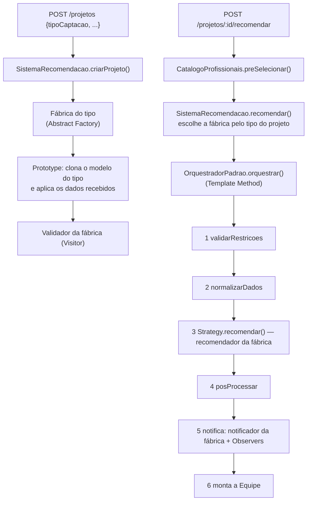

# 📚 DSM – Desenvolvimento de Software Multiplataforma – FATEC/SJC

Atividades práticas **ATV1**, **ATV2** e **ATV3** – TP.II - Técnicas de Programação II · Prof. Dr. Eng. Gerson Penha.

# 🎬 CineBridge – Recomendação e Orquestração de Equipes

Microsserviço REST que recebe as especificações técnicas de um projeto audiovisual, analisa o perfil dos profissionais cadastrados e compõe automaticamente uma equipe equilibrada — notificando os envolvidos e permitindo ajustes dinâmicos ao longo do processo.

Suporta **documentário, animação e publicitário**, cada um com a sua família de objetos (projeto, validador, recomendador e notificador). Depois da recomendação, o produtor convida os membros propostos, os profissionais respondem, e a equipe pode ser reavaliada ou ter membros substituídos; quando todos os papéis confirmam, a equipe é formada e os outros microsserviços são avisados.

> Série de exercícios que incrementam este mesmo projeto ao longo do semestre. A **ATV1** aplicou padrões comportamentais (Strategy, Template Method, Observer, Visitor); a **ATV2** acrescentou os criacionais (Prototype, Abstract Factory) sobre a mesma base; a **ATV3** acrescentou os estruturais (Adapter, Composite, Decorator) e a [análise de anti-padrões](docs/anti-padroes.md). O histórico está no Git: tags `av1-entrega` e `av2-entrega`, branches `atv2` e `atv3`.

## 📑 Sumário

- [📋 Requisitos](#-requisitos)
- [🛠 Tecnologias](#-tecnologias)
- [🚀 Como executar](#-como-executar)
- [🗂 Estrutura do projeto](#-estrutura-do-projeto)
- [🏗 Padrões de projeto aplicados](#-padrões-de-projeto-aplicados)
- [📐 Mapeamento UML → código e premissas](#-mapeamento-uml--código-e-premissas)
- [👥 Fluxo da equipe](#-fluxo-da-equipe)
- [🖥 Endpoints](#-endpoints)
- [🔧 Variáveis de ambiente](#-variáveis-de-ambiente)
- [🧪 Testes](#-testes)
- [⚡ Desempenho](#-desempenho)
- [🔩 Scripts de demonstração manual](#-scripts-de-demonstração-manual)
- [🖥 Compatibilidade](#-compatibilidade)
- [💾 Persistência de dados](#-persistência-de-dados)
- [⚠️ Limitações conhecidas](#️-limitações-conhecidas)
- [🎯 Conceitos aplicados](#-conceitos-aplicados)

## 📋 Requisitos

- Node.js (versão LTS)
- Docker Desktop com Docker Compose (o Postgres roda em container)

## 🛠 Tecnologias

### ⚙️ Back-end (Linguagem e Frameworks)

<p align="left">
<a href="https://nodejs.org" target="_blank" rel="noopener noreferrer">

</a>
<a href="https://www.typescriptlang.org" target="_blank" rel="noopener noreferrer">

</a>
<a href="https://fastify.dev" target="_blank" rel="noopener noreferrer">

</a>
<a href="https://typeorm.io" target="_blank" rel="noopener noreferrer">

</a>
</p>

### 🗄 Banco de dados

<p align="left">
<a href="https://www.postgresql.org" target="_blank" rel="noopener noreferrer">

</a>
</p>

### 🧪 Testes

<p align="left">
<a href="https://jestjs.io" target="_blank" rel="noopener noreferrer">

</a>
</p>

### 🐳 Infraestrutura

<p align="left">
<a href="https://www.docker.com" target="_blank" rel="noopener noreferrer">

</a>
</p>

Versões: Node.js LTS · TypeScript 5.5 (modo `strict`) · Fastify 4 · TypeORM 0.3 · PostgreSQL 18 · Jest 30 + ts-jest.

## 🚀 Como executar

Resumo rápido (pressupõe Node.js LTS e Docker Desktop já instalados e **abertos**):

```bash
git clone https://github.com/Costa-Wagner/cinebridge.git
cd cinebridge
npm install
cp .env.example .env
docker compose up -d
npm run seed
npm run dev
```

> **Atualizando de uma versão anterior?** A imagem do banco passou de PostgreSQL 16 para 18 (o enunciado pede a versão mais recente). Os dados de um volume antigo não são reaproveitados: rode `docker compose down -v` antes do `up -d` e refaça o `npm run seed`.

**Guia completo, passo a passo — com instalação de pré-requisitos, instruções específicas para Ubuntu/WSL2 e solução de problemas comuns**: [docs/execucao.md](docs/execucao.md).

## 🗂 Estrutura do projeto

```
src/
├── aplicacao/       # ServicoProjetos (casos de uso) + CatalogoProfissionais (cadastro em memória)
├── config/          # DataSource TypeORM, perfil de competências por papel
├── domain/
│   ├── entities/    # Projeto (+ 3 subclasses), Profissional, Equipe, MembroEquipe, Convite, Recomendacao...
│   ├── enums/       # Papel, StatusConvite, StatusEquipe, TipoCaptacao
│   ├── prototipos/  # RegistroPrototipos
│   ├── servicos/    # Composite: ServicoProjeto, ServicoAtomico, PacoteServico
│   └── erros.ts
├── fabricas/        # FabricaProjeto + famílias documentario/, animacao/, publicitario/
├── strategies/      # PontuacaoStrategy (algoritmos) + RecomendacaoStrategy (contrato do diagrama)
├── orquestrador/    # Template Method (OrquestradorEquipe / OrquestradorPadrao)
├── adaptadores/     # Adapter: armazenamento, pagamento, profissional + sistemas externos simulados
├── decoradores/     # Decorator: cache, auditoria, compressão e a pilha configurável
├── observers/       # Observer: SistemaRecomendacao (sujeito) e observadores
├── visitors/        # Visitor: validação, compatibilidade, relatório
├── eventos/         # Barramento de eventos entre microsserviços (EventEmitter)
├── integracao/      # Testes de integração (Postgres) e teste de carga
├── app.ts           # Rotas Fastify
├── composicao.ts    # Raiz de composição: fábricas + observadores
├── server.ts        # Entrypoint HTTP
└── seed.ts          # Dados de exemplo
```

Os testes unitários (`*.test.ts`) ficam ao lado do arquivo que testam; os de integração são `*.integration.test.ts`, em `src/integracao/`.

## 🏗 Padrões de projeto aplicados



| Padrão | Onde | Papel no projeto |
|---|---|---|
| **Strategy** | `strategies/` | `PontuacaoStrategy` (Similaridade de cosseno, Filtragem colaborativa, Regras de orçamento, Híbrida, Animação) e `RecomendacaoStrategy` (contrato do diagrama: `Map<Papel, Profissional[]>`), ligadas por `RecomendadorPorPontuacao` |
| **Template Method** | `orquestrador/` | `OrquestradorEquipe.orquestrar()` fixa a ordem do fluxo e **não pode ser sobrescrito** (o construtor recusa); `OrquestradorPadrao` implementa `validarRestricoes`, `normalizarDados` e `posProcessar` |
| **Observer** | `observers/` | `SistemaRecomendacao` notifica seis tipos de evento (recomendação, convite enviado/aceito/recusado, substituição, equipe formada) a `ServicoEmail`, `ServicoMensagensInternas`, `ModuloAuditoria` (log JSON) e `IntegradorMicrosservicos`. Um observador com falha não impede os demais |
| **Visitor** | `visitors/` | `ValidadorConsistencia` e os validadores por tipo (criados pela fábrica) rodam em toda criação e orquestração via `projeto.aceitar(validador)`; `CalculadorCompatibilidade` e `GeradorRelatorio` operam sobre as mesmas entidades sem alterá-las |
| **Prototype** | `domain/entities/Projeto*.ts`, `domain/prototipos/` | `Projeto.clonar()` (cópia profunda, sem id nem relações) e `RegistroPrototipos`; cada fábrica guarda o modelo do seu tipo |
| **Abstract Factory** | `fabricas/` | `FabricaProjeto` cria a família completa de cada tipo; o orquestrador e o `SistemaRecomendacao` não conhecem nenhum tipo concreto (um teste automatizado verifica isso) |
| **Adapter** | `adaptadores/` | `AdaptadorArmazenamento` (S3, Google Cloud, Local), `AdaptadorPagamento` (Stripe, PagSeguro, PayPal) e `AdaptadorProfissional` (LinkedIn, Indeed, Interno) sobre sistemas externos simulados em `adaptadores/externos/`. `SistemaRecomendacao.configurarAdaptadores()` recebe as instâncias; trocar de provedor é trocar a instância. O `AdaptadorInterno` usa o `CatalogoProfissionais` |
| **Composite** | `domain/servicos/` | `ServicoProjeto` (`calcularCusto`, `listarSubservicos`, `obterPrazo`, `validar`), `ServicoAtomico` e `PacoteServico` (prazo `SEQUENCIAL` ou `PARALELO`). `Projeto.servicoPrincipal` (jsonb) guarda a árvore; `papeisObrigatorios` é derivado das folhas |
| **Decorator** | `decoradores/` | `CacheDecorator`, `AuditoriaDecorator` e `CompressaoDecorator` envolvem qualquer `RecomendacaoStrategy` (base: `RecomendadorBase`). A pilha é configurável em tempo de execução (ver abaixo) |

**Composite na API:** `POST /projetos` aceita `servicoPrincipal` (árvore em JSON com `tipo: "ATOMICO" | "PACOTE"`); ele tem precedência sobre `papeisObrigatorios`. Sem ele, cada papel vira um serviço atômico de custo 0 e prazo de 1 dia.

```json
{ "tipo": "PACOTE", "nome": "Pós-produção", "modo": "SEQUENCIAL", "servicos": [
  { "tipo": "ATOMICO", "nome": "Edição", "papel": "EDITOR", "peso": 8, "custo": 4000, "prazoDias": 10 },
  { "tipo": "PACOTE", "nome": "Áudio", "modo": "PARALELO", "servicos": [
    { "tipo": "ATOMICO", "nome": "Mixagem", "papel": "SONOPLASTA", "peso": 6, "custo": 2500, "prazoDias": 6 } ] } ] }
```

**Pilha de decoradores:** a lista é a ordem de aplicação (o último nome é a camada externa). Três formas de configurar: variável `DECORADORES` (padrão `CACHE`), `PUT /configuracao/decoradores` (`{"pilha": ["CACHE","AUDITORIA","COMPRESSAO"]}`, vale para as próximas recomendações) e `{"decoradores": [...]}` no corpo de `POST /projetos/:id/recomendar` (só para aquela chamada). O cache tem validade de 30 s: uma nova avaliação só aparece no ranking depois disso.

**Famílias por tipo** (premissas de domínio):

| Tipo | Papéis padrão | Validador exige | Recomendador | Notificador |
|---|---|---|---|---|
| Documentário | Diretor, Roteirista, Dir. Fotografia, Editor, Sonoplasta | `tema` e ao menos 1 entrevistado | 60% cosseno + 40% filtragem colaborativa | tema e entrevistados |
| Animação | Diretor, Efeitos Visuais, Roteirista, Editor, Sonoplasta | `softwareModelagem` e o papel de Efeitos Visuais | Cosseno + bônus de até 2 pontos por domínio do software | métricas de renderização |
| Publicitário | Diretor, Dir. Fotografia, Editor | `cliente` e `canal` | 50% cosseno + 50% regras de orçamento | cliente e canal |

**Novo tipo sem alterar o orquestrador:** basta criar uma fábrica e registrá-la em `composicao.ts` (`sistema.registrarFabrica(tipo, fabrica)`). `src/fabricas/Extensibilidade.test.ts` demonstra com uma `FabricaRealidadeVirtual` definida só no teste.

## 📐 Mapeamento UML → código e premissas

| Diagrama da ATV2 | Código |
|---|---|
| `Projeto` (`clonar`, `aceitarRecomendacao`, `substituirMembro`, `solicitarReavaliacao`) | `domain/entities/Projeto.ts` |
| `ProjetoDocumentario` / `ProjetoAnimacao` / `ProjetoPublicitario` | `domain/entities/Projeto*.ts` (tabela única `projetos`, discriminador `tipoCaptacao`) |
| `FabricaProjeto` + `FabricaDocumentario` / `FabricaAnimacao` / `FabricaPublicitario` | `fabricas/` |
| `RecomendacaoStrategy`, `Recomendador*` | `strategies/RecomendacaoStrategy.ts`, `fabricas/*/Recomendador*.ts` |
| `VisitanteProjeto`, `Validador*` | `visitors/VisitanteProjeto.ts`, `fabricas/*/Validador*.ts` |
| `Observador`, `EventoRecomendacao`, `Notificador*` | `observers/Observador.ts`, `observers/EventoRecomendacao.ts`, `fabricas/*/Notificador*.ts` |
| `OrquestradorEquipe`, `OrquestradorPadrao` | `orquestrador/` |
| `Equipe`, `MembroEquipe` | `domain/entities/` |

O diagrama entregue está **cortado na borda direita**; o que não aparece nele foi assumido e fica registrado aqui:

- Campos de `ProjetoAnimacao` (`softwareModelagem`, `metricasRenderizacao`) e de `ProjetoPublicitario` (`cliente`, `canal`) são premissas; `ProjetoDocumentario` (`tema`, `entrevistados`) vem do diagrama.
- `orquestrar(projeto, profissionais, estrategia?, papeis?)` difere da assinatura do diagrama: os profissionais disponíveis são entregues pelo chamador, a estratégia é opcional (por padrão vem da fábrica) e `papeis` restringe a rodada a alguns papéis (usado ao substituir um membro).
- `substituirMembro(papel, profissional)`: `profissional` é quem o produtor **dispensa**.
- `FabricaProjeto.criarValidador()` devolve `ValidadorConsistencia` (um `VisitanteProjeto` que acumula `problemas`), subtipo compatível com o diagrama.
- A pontuação não faz parte do contrato `RecomendacaoStrategy`; por isso `Recomendacao.pontuacao` é nula no histórico (posição e recomendador são gravados).

## 👥 Fluxo da equipe

```
recomendar ──► equipe EM_FORMACAO, membros PROPOSTOS
                   │ produtor: aceitar            │ produtor: substituir (só aquele papel)
                   ▼                              ▼
             convite PENDENTE              dispensado sai; nova rodada para o papel
                   │ profissional responde
         ┌─────────┴─────────┐
         ▼                   ▼
   CONFIRMADO            RECUSADO ──► produtor decide (substituir)
         │ todos os papéis confirmados
         ▼
   equipe FORMADA ──► evento "equipe.formada" ──► gerenciamento de projetos e financeiro
```

- `reavaliar` mantém quem já confirmou, cancela convites pendentes e refaz o restante (aceita `orcamentoTotal` e `dataEntrega` novos).
- Quem foi dispensado num papel não volta a ser sugerido para ele.
- `POST /projetos/:id/recomendar` só vale enquanto não há convites; depois use `reavaliar`.

## 🖥 Endpoints

| Método | Rota | Descrição | Respostas |
|---|---|---|---|
| GET | `/health` | Servidor no ar | 200 |
| POST | `/projetos` | Cria um projeto pela fábrica do `tipoCaptacao` | 201, 400, 422 |
| POST | `/projetos/:id/recomendar` | Recomenda e grava a equipe proposta (+ alternativas por papel) | 200, 404, 409, 422 |
| GET | `/projetos/:id/equipe` | Equipe atual com a situação de cada membro | 200, 404 |
| GET | `/configuracao/decoradores` | Pilha de decoradores vigente e as opções | 200 |
| PUT | `/configuracao/decoradores` | Troca a pilha em tempo de execução (`{"pilha": [...]}`) | 200, 400 |
| GET | `/projetos/:id/recomendacoes` | Histórico de rankings por papel (todas as rodadas) | 200, 404 |
| POST | `/projetos/:id/equipe/aceitar` | Produtor aprova um membro: cria o convite | 201, 404, 409 |
| POST | `/projetos/:id/equipe/substituir` | Produtor dispensa um membro e refaz só aquele papel | 200, 404, 409 |
| POST | `/projetos/:id/reavaliar` | Refaz os papéis não confirmados | 200, 404, 409, 422 |
| POST | `/convites/:id/responder` | Profissional aceita ou recusa (`{"aceito": true}`) | 200, 404, 409 |

Códigos: `400` corpo fora do esquema · `404` não encontrado · `409` operação incompatível com o estado · `422` regras do tipo violadas (a resposta traz a lista `problemas`).

```bash
# 1) criar um documentário
curl -X POST http://localhost:3000/projetos -H "content-type: application/json" -d '{
  "tipoCaptacao": "DOCUMENTARIO", "duracaoEstimadaMinutos": 80, "orcamentoTotal": 60000,
  "dataEntrega": "2026-12-10", "localizacaoFilmagem": "Santos",
  "tema": "Mares", "entrevistados": ["Ana", "Beto"] }'

# 2) recomendar a equipe (use o id devolvido)
curl -X POST http://localhost:3000/projetos/<id>/recomendar -H "content-type: application/json" -d '{}'

# 3) convidar um membro proposto e responder ao convite
curl -X POST http://localhost:3000/projetos/<id>/equipe/aceitar -H "content-type: application/json" \
  -d '{"papel": "DIRETOR", "profissionalId": "<id-do-profissional>"}'
curl -X POST http://localhost:3000/convites/<conviteId>/responder -H "content-type: application/json" -d '{"aceito": true}'
```

> Recomenda-se Thunder Client ou Insomnia para visualizar as respostas. Requisições `POST` sem corpo devem usar `No Body` (ou `{}`) — `Content-Type: application/json` com corpo vazio causa erro `415`.

## 🔧 Variáveis de ambiente

| Variável | Descrição | Padrão (`.env.example`) |
|---|---|---|
| `DB_HOST` | Host do Postgres | `localhost` |
| `DB_PORT` | Porta do Postgres | `5432` |
| `DB_USER` | Usuário do Postgres | `postgres` |
| `DB_PASSWORD` | Senha do Postgres | `postgres` |
| `DB_NAME` | Nome do banco | `cinebridge` |
| `PORT` | Porta do servidor Fastify | `3000` |
| `DECORADORES` | Pilha de decoradores da recomendação, em ordem de aplicação (`CACHE`, `AUDITORIA`, `COMPRESSAO`; vazio = nenhum) | `CACHE` |

Opcionais (testes): `DB_NAME_TEST` (padrão `cinebridge_test`) e `DB_NAME_CARGA` (padrão `cinebridge_carga`). Os testes de integração e de carga criam esses bancos sozinhos e **nunca tocam no banco de desenvolvimento**. O `docker-compose.yml` lê as variáveis do `.env`.

## 🧪 Testes

```bash
npm test                  # unitários (não precisam de Docker)
npm run test:coverage     # unitários + cobertura (mínimo de 80% configurado)
npm run test:integration  # integração com Postgres real (exige: docker compose up -d)
npm run carga             # teste de carga do requisito de desempenho (exige o Postgres)
```

| Nível | Quantidade | O que cobre |
|---|---|---|
| Unitários | **317 testes, 31 suítes** — 100% das linhas e dos *statements*, ~96% dos ramos | Strategies, Template Method (incl. invariância do fluxo), Observer (incl. isolamento de falhas), Visitor, Prototype, fábricas, domínio do fluxo de convite, serviço, API e catálogo; Adapter (9 adaptadores), Composite (árvores de vários níveis) e Decorator (cache, auditoria, compressão e pilhas em ordens diferentes) |
| Integração | **47 testes, 5 suítes** | Adapter: troca de armazenamento, pagamento e fonte de profissionais sem alterar o código de negócio; Composite: árvore persistida e reidratada; Decorator: cache evita recálculo, auditoria registra, pilha trocada por API. Além disso: API → serviço → Postgres: criação por tipo, equipes consistentes com o tipo, notificações por tipo, persistência e substituição da equipe, troca de strategy alterando o resultado, Visitor sobre as mesmas entidades, fluxo completo de convites até a equipe formada (com evento externo), histórico de recomendações |
| Carga | 1 script | 10 mil profissionais, 100 requisições simultâneas (ver [Desempenho](#-desempenho)) |

Os testes unitários usam fakes e rodam com o Docker parado. Entidades (`domain/entities/`), `config/`, `server.ts`, `composicao.ts` e `integracao/` ficam fora do cálculo de cobertura (`jest.config.js`) por serem decorators do TypeORM, *setup* e infraestrutura de teste; a lógica que usa as entidades é coberta pelos testes de domínio e de integração.

O roteiro manual da rota HTTP e a evidência bruta de cobertura em Windows e Ubuntu estão em [docs/testes.md](docs/testes.md).

## ⚡ Desempenho

Requisito: recomendações em até **2 s** com até **10 mil profissionais** ativos e **100 requisições simultâneas**.

Duas decisões sustentam o requisito:

1. **`CatalogoProfissionais`**: o `find({ relations })` do TypeORM gera produto cartesiano e estoura a memória do Node com 10 mil registros (medido: 99 requisições simultâneas derrubavam o processo). O catálogo lê o cadastro com 4 consultas simples, monta as entidades em O(n), o compartilha entre as requisições (uma única leitura, mesmo com requisições simultâneas), o renova a cada 60 s e o invalida quando os convites mudam. O servidor o carrega na subida.
2. **Pré-seleção por aderência**: a cada carga do cadastro, monta-se por papel um ranking de aderência (cosseno com o perfil do papel). A recomendação recebe só os 30 mais aderentes de cada papel e cada tipo de projeto os reordena com os seus critérios (reputação, orçamento, software). É a estratégia usual de *geração de candidatos + ranqueamento*: o custo por requisição não cresce com o cadastro. O trade-off é que um profissional fora dos 30 mais aderentes de um papel nunca é considerado para ele (`LIMITE_PRESELECAO`).

**Medições** (`npm run carga`, 10 mil profissionais, 100 requisições simultâneas, API em memória; limite: p95 ≤ 2 s com o cadastro em memória):

| Ambiente | Custo por requisição | p95 (cadastro em memória) | Resultado |
|---|---|---|---|
| Referência: Ubuntu 24.04, Postgres 16 local | 8–10 ms | **0,75–0,97 s** | Atende |
| Windows 10+, Docker Desktop, Postgres 18 | ~36 ms | **~3,6 s** | **Não atende** o limite de 2 s |

O Node executa o código da aplicação em uma única thread: com 100 requisições simultâneas, o tempo total é proporcional ao custo de processamento por requisição, e esse custo varia com a velocidade do processador. Na medição em Windows o banco não é o gargalo (ida e volta de ~1,4 ms); o custo de processamento é cerca de 3,5 vezes maior que no ambiente de referência. A rodada com cadastro "frio" (a primeira requisição lê os 10 mil profissionais) é só informativa: levou ~7,5 s no Windows, e por isso o servidor carrega o cadastro na subida.

O script imprime ao final um diagnóstico (ida e volta ao banco, uma requisição isolada e custo médio por requisição) para interpretar o resultado em qualquer máquina. Parâmetros: `PROFISSIONAIS`, `REQUISICOES`, `LIMITE_MS`; `DB_POOL` ajusta as conexões simultâneas com o banco (padrão 20).

Caminhos para reduzir o custo em hardware mais lento: o `CacheDecorator` da ATV3 (evita recalcular recomendações repetidas; ativo por padrão em `DECORADORES=CACHE`, ainda sem medição neste quadro) e executar mais de um processo Node (`cluster`), que usa todos os núcleos do processador.

## 🔩 Scripts de demonstração manual

```bash
npm run test:orquestrador  # Strategy + Template Method + Observer, ponta a ponta com o banco
npm run test:visitors      # Visitor, percorrendo projeto + profissionais seedados
```

Diferente dos testes Jest, esses scripts executam contra o Postgres de desenvolvimento — exigem `docker compose up -d` e `npm run seed`.

## 🖥 Compatibilidade

| Sistema | Situação |
|---|---|
| Windows 10+ | Desenvolvimento e testes (unitários e de integração) |
| Ubuntu 24.04 | ATV1 validada ponta a ponta via WSL2; na ATV2 e na ATV3, suítes unitária e de integração executadas em Ubuntu 24.04 nativo (com Postgres local) |

Os adaptadores e o `AdaptadorLocal` usam apenas `path`, `os` e `fs` do Node (separadores e pasta temporária do sistema); o diretório de mídia pode ser definido por `ARMAZENAMENTO_DIR`.

## 💾 Persistência de dados

PostgreSQL 18 via Docker Compose (`postgres:18-alpine`), com volume nomeado `cinebridge_pgdata` montado em `/var/lib/postgresql` (layout exigido pela imagem 18). O schema é criado pelo TypeORM (`synchronize`). `npm run seed` popula profissionais e um projeto de animação de exemplo.

Tabelas principais: `projetos` (tabela única para os três tipos), `profissionais`, `competencias`, `profissional_competencias`, `avaliacoes`, `equipes`, `membros_equipe`, `convites` e `recomendacoes` (histórico).

## ⚠️ Limitações conhecidas

- `Recomendacao.pontuacao` fica nula: o contrato do diagrama devolve só a ordem dos candidatos.
- O schema usa `synchronize` (adequado para este exercício); em produção seriam migrations.
- A comunicação entre serviços é em memória (`EventEmitter`); o barramento tem interface própria para trocar por RabbitMQ sem mudar quem publica. Gerenciamento de projetos e financeiro são consumidores simulados.
- A pré-seleção por aderência é aproximada (ver [Desempenho](#-desempenho)).
- A auditoria é um log JSON por evento; não há tabela de auditoria.
- Os sistemas externos (S3, Google Cloud, gateways de pagamento, LinkedIn, Indeed) são **simulados em memória**; nenhum adaptador faz chamada de rede. Provedores externos não informam nível de competência: assume-se 7.
- Nenhum fluxo de produção usa ainda os adaptadores de armazenamento e pagamento; eles ficam disponíveis no `SistemaRecomendacao` e são exercitados pelos testes de integração.
- O `CompressaoDecorator` comprime e mede o resultado, mas o contrato `RecomendacaoStrategy` continua devolvendo o mapa original; o pacote gzip fica em `ultimoPacote`.
- `CalculadorCompatibilidade` e `GeradorRelatorio` (Visitor) não têm rota HTTP; são exercitados por testes e pelo script `test:visitors`.

## 🎯 Conceitos aplicados

- Node.js + TypeScript em modo estrito; Fastify e API REST (verbos, códigos de status e validação de esquema)
- TypeORM: herança de tabela única (`@TableInheritance`/`@ChildEntity`), `jsonb`, relações e transações
- Padrões de projeto: Strategy, Template Method, Observer, Visitor, Prototype, Abstract Factory, Adapter, Composite, Decorator
- Anti-padrões: análise do código e refatorações em [docs/anti-padroes.md](docs/anti-padroes.md)
- Injeção de dependência explícita por construtor e raiz de composição (`composicao.ts`)
- Testes unitários, de integração e de carga com Jest; cobertura de código
- Comunicação entre serviços por eventos (`EventEmitter`)
- Desempenho: carga O(n), cache compartilhado e geração de candidatos
