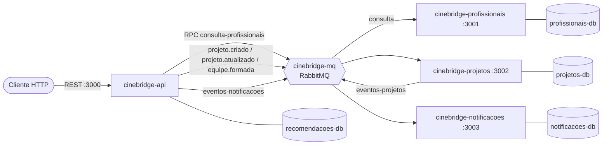

# Containerização da CineBridge (ATV4)

A plataforma roda em contêineres: **4 microsserviços**, **1 RabbitMQ** e **1 PostgreSQL por domínio**, ligados pela rede `cinebridge-net`. Este documento descreve a arquitetura, como executar, como verificar e as decisões tomadas.

## Visão geral



Os serviços não se chamam por HTTP: toda comunicação entre eles passa por filas do RabbitMQ.

## Contêineres, imagens e portas

| Contêiner | Imagem | Porta no host | Papel |
|---|---|---|---|
| `cinebridge-api` | build de `docker/api.Dockerfile` | 3000 | Recomendação e orquestração; ponto de entrada REST |
| `cinebridge-profissionais` | build de `docker/profissionais.Dockerfile` | 3001 | Dono do cadastro de profissionais; responde consultas por fila |
| `cinebridge-projetos` | build de `docker/projetos.Dockerfile` | 3002 | Registro do ciclo de vida dos projetos; publica `eventos-projetos` |
| `cinebridge-notificacoes` | build de `docker/notificacoes.Dockerfile` | 3003 | Envia e registra e-mails e mensagens internas |
| `cinebridge-mq` | `rabbitmq:3-management-alpine` | 5672 (AMQP), 15672 (interface web) | Barramento de mensagens |
| `recomendacoes-db` | `postgres:18-alpine` | 5434 | Banco da api |
| `profissionais-db` | `postgres:18-alpine` | 5432 | Banco do serviço de profissionais |
| `projetos-db` | `postgres:18-alpine` | 5433 | Banco do serviço de projetos |
| `notificacoes-db` | `postgres:18-alpine` | 5435 | Banco do serviço de notificações |

As portas dos bancos no host servem só para consulta e testes; entre contêineres tudo usa a porta 5432 e o nome do serviço (por exemplo `projetos-db`).

## Filas

| Fila | Quem publica | Quem consome | Conteúdo |
|---|---|---|---|
| `consulta-profissionais` | api | profissionais | RPC: listar, detalhar e avaliar profissionais. A resposta volta numa fila exclusiva `rpc.resposta.<uuid>` por instância da api, com `correlationId` por requisição (timeout de 5 s, configurável em `RPC_TIMEOUT_MS`) |
| `projeto.criado`, `projeto.atualizado` | api | projetos | Resumo do projeto (tipo, gênero, orçamento, entrega, custo e prazo) |
| `equipe.formada` | api | projetos | Equipe confirmada; marca o projeto como finalizado |
| `eventos-projetos` | projetos | notificacoes | `PROJETO_CRIADO`, `PROJETO_ATUALIZADO`, `PROJETO_FINALIZADO` |
| `eventos-notificacoes` | api | notificacoes | Eventos da recomendação: recomendação gerada, convite enviado/aceito/recusado, membro substituído, equipe formada |

Todas as filas são duráveis, as mensagens são persistentes, a publicação espera a confirmação do broker (confirm channel) e o consumidor confirma (ack) só depois de tratar a mensagem.

## Como executar

Pré-requisitos: Docker Desktop (Windows 10+, com WSL2) ou Docker Engine com o plugin Compose (Ubuntu 24.04+), e um arquivo `.env` na raiz criado a partir de `.env.example` (as credenciais `DB_USER`, `DB_PASSWORD` e `DB_NAME` são usadas pelo compose).

```bash
docker compose up -d --build     # constrói as 4 imagens e sobe os 9 contêineres
docker compose ps                # todos devem ficar "healthy"
docker compose logs -f cinebridge-notificacoes   # acompanhar os envios simulados
docker compose down              # para e remove os contêineres (os dados ficam nos volumes)
docker compose down -v           # idem, apagando também os dados
```

A primeira construção leva alguns minutos. Os serviços esperam o próprio banco e o RabbitMQ ficarem saudáveis (`depends_on` com `service_healthy`); a api espera também o serviço de profissionais. O serviço de profissionais cria o cadastro inicial sozinho se o banco estiver vazio.

Para rodar só a infraestrutura e os serviços pelo `npm` (desenvolvimento), veja o README: `docker compose up -d cinebridge-mq recomendacoes-db profissionais-db projetos-db notificacoes-db`, depois `npm run servico:profissionais`, `npm run servico:projetos`, `npm run servico:notificacoes` e `BARRAMENTO=rabbitmq PROFISSIONAIS_VIA=mq npm run dev`.

## Health checks

Cada serviço expõe `GET /health`, que responde 200 só se o banco e o RabbitMQ respondem e 503 com a lista do que falhou. O `docker-compose.yml` usa esse endpoint no `healthcheck` de cada serviço (`wget --spider`; a imagem Alpine não tem `curl`). Os bancos usam `pg_isready` e o RabbitMQ usa `rabbitmq-diagnostics ping`.

## Verificação ponta a ponta

Com a stack no ar:

```bash
bash scripts/verificar-stack.sh      # ou: npm run verificar:stack
```

O script cria um projeto, pede a recomendação, aceita todos os convites e confere: saúde dos 4 serviços; recomendação com os 2 papéis; equipe formada; projeto `FINALIZADO` no serviço de projetos; as 6 notificações esperadas (todas `ENVIADA`); e as 6 filas no RabbitMQ sem mensagens pendentes e com consumidor. Sai com código 1 se algo falhar. Precisa de `bash`, `curl` e `node` na máquina (no Windows, o Git Bash).

A interface do RabbitMQ fica em `http://localhost:15672` (usuário e senha `guest`/`guest` por padrão) e mostra filas, taxas de entrega e erros. Cada serviço também permite consulta direta: `GET :3002/projetos/<id>` e `GET :3003/notificacoes?projetoId=<id>`.

## Decisões

- **Padrões reaproveitados.** Adapter (`AdaptadorMensageria` implementa `AdaptadorProfissional`; o `AdaptadorInterno` continua valendo no modo local), Decorator (`AdaptadorProfissionalComProjecao`), Observer (`PublicadorNotificacoes` leva os eventos da recomendação para a fila) e Strategy (enviadores de notificação por canal).
- **Dois modos de execução.** `BARRAMENTO=memoria` (padrão) mantém tudo dentro de um processo, como nas atividades anteriores; `BARRAMENTO=rabbitmq` e `PROFISSIONAIS_VIA=mq` ligam a arquitetura distribuída. Os testes unitários e de integração anteriores seguem valendo nos dois modos.
- **Um banco por serviço.** Projetos e notificações têm banco e entidade próprios. O serviço de profissionais reaproveita as entidades da api.
- **Projeção local de profissionais.** Convites, recomendações e equipes da api referenciam profissionais por chave estrangeira, e chave estrangeira não atravessa bancos. A cada consulta ao serviço de profissionais, a api grava o profissional numa tabela local (upsert) e anexa os convites do histórico, que a filtragem colaborativa usa. O dono do cadastro continua sendo o serviço de profissionais.
- **Imagens.** Dockerfiles multi-stage em `node:22-alpine`: compila com `tsc` e a imagem final leva só dependências de produção e o JavaScript compilado, rodando como usuário não-root. Os quatro diferem apenas na porta e no comando de inicialização.

## Diferenças em relação ao enunciado

- `node:22-alpine` em vez de `node:18-alpine` (o Node 18 saiu de suporte; a especificação do projeto pede versão LTS).
- `postgres:18-alpine` em vez de `postgres:15-alpine` (a especificação pede a versão mais recente).
- Os Dockerfiles ficam em `docker/` e o contexto de build é a raiz; são multi-stage em vez de `npm install` direto.
- Health check com `wget`, porque `curl` não existe na imagem Alpine.
- A fila de retorno do RPC tem nome único por instância da api (não por requisição); cada requisição se distingue pelo `correlationId`.
- Cada tópico é uma fila de mesmo nome, com um único serviço consumidor.
- A rede `cinebridge-net` é do tipo bridge, sem a opção `internal`, porque as portas precisam ser publicadas no host.

## Limitações conhecidas

- O serviço de profissionais usa as entidades compartilhadas da api, então `profissionais-db` tem também tabelas vazias que não são do seu domínio.
- Mensagem cujo tratamento falha é descartada (nack sem reenfileirar), sem fila de mensagens mortas. A entrega é pelo menos uma vez, então duplicatas são possíveis: o serviço de projetos nunca regride o status, mas o de notificações pode registrar uma notificação repetida.
- Não há serviço financeiro: o evento `equipe.formada` é consumido só pelo serviço de projetos. Em modo local o consumidor financeiro continua simulado.
- Os sistemas externos dos adaptadores (armazenamento, pagamento, cadastro profissional) continuam simulados.
- Banco criado por `synchronize` e credenciais `guest` e do `.env`: adequado para desenvolvimento e avaliação, não para produção.
- O teste de carga (`npm run carga`) depende do processador da máquina (limite de 2 s de p95).
- As imagens foram preparadas para Docker; Podman e nerdctl não foram testados.

## Compatibilidade

Windows 10 ou superior (Docker Desktop) e Ubuntu 24.04 ou superior e derivados (Docker Engine com Compose). O script de verificação usa `bash`, `curl` e `node`; no Windows, rode-o pelo Git Bash. O `.gitattributes` mantém os scripts e Dockerfiles com fim de linha LF.
